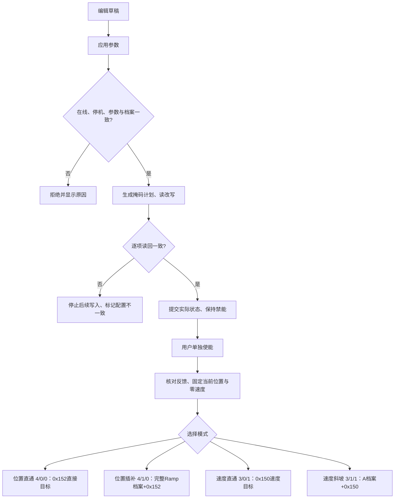

# TMC6460 PID 与运动参数整合

日期：2026-11-02。状态：源码与离线测试；未烧录、未连接或运动电机，未重打包EXE。
上位机目录：`C:/Users/23517/Desktop/电机调试/TSLViewer`。

## 1. 依据及现有实现分析

依据本地 `tmc6460.pdf`，Rev.0（03/26），重点核对p.75–76、80–84、91–97、
155–168、173–177。使用本地PDF提取文本核对，不能以页面字段名称推断寄存器。

| 对象 | 原实现及定位 | 本次处理 |
|---|---|---|
| PID页/数据 | `src/pages/Tuning.tsx`、`PidCfgPayload`、Rust `procs::PidCfg` | 保留Q格式、归一化、移位；Id/Iq独立编辑；共用每电机草稿 |
| 运动页/数据 | `src/components/MotorControls.tsx`、`src/lib/motor-control.ts`、`motor_control::Config` | 任务限制、规划和保护；不拥有驱动器上限 |
| UART访问 | `src-tauri/src/link.rs`、`proto.rs`；网关经`gateway.rs`到主控16路UART | 复用原链路，不新增帧协议 |
| 单位 | `src/lib/units.ts`；旧`motor_control.rs`写死MA/VEL | 新`motor_parameters.rs`统一后端换算，校验当前闭环档案 |
| 限幅 | 旧运动页整字写`0x14A`且低16位置零，重复写`0x14B` | 驱动器/任务分层；任务仅更新Iq字段，保留Id |
| 位置运动 | 桌面线程60ms下发五次曲线位置目标 | 主模式改原生Ramp；位置直通仍可用，正弦流式目标仅直通 |
| 速度运动 | 旧`procs::start_velocity`和axis调试入口独立存在 | 本页新支持速度直通/原生速度Ramp；旧专用调试入口保留 |
| 停止 | 原“停止电机”即PWM OFF；停止工况维持目标 | 明确减速停止、保持/速度归零、断使能、急停 |
| 持续过流 | 桌面worker按连续3次abs(Iq)超阈值 | 独立时长状态机，按电机锁存，明确通信依赖 |
| 存储 | `storage.rs`电机板M24C02，TSL1版本1 A/B两个112B块、CRC8 | 保留原格式；新增任务/保护不冒充已持久化 |
| 恢复 | EEPROM加载只返回参数，前端显式应用；没有自动安全恢复全套控制参数 | 不自动恢复/使能；重新连接需读回或显式应用PID |

发现的差异：手册p.86正文写PWM_EXT=9，p.155寄存器表写PWM_EXT=10，且9已经
是PRBS_POSITION。本页只列示这些诊断模式，不自动下发任何有歧义的诊断模式。
手册p.96说明速度Ramp不使用D1/D2/D_MAX、V_START/V_STOP/V_MAX；故速度Ramp
要求UI加减速度相等，使用A参数双向加减速，软件校验速度目标不能超过生效限制。

## 2. 参数所有权和模块

`src/lib/motor-configuration.ts`：按M1–M16隔离的PID与任务**编辑草稿**，跨页共享，
改输入不写芯片，不从磁盘自动执行。组合标定页面复用此PID草稿，删除其另存一套
PID数值的入口，避免组合流程和PID页互相覆盖。

`src-tauri/src/motor_parameters.rs`：`RegisterAccess`、`RegisterWrite/execute`、
单位/位域编解码、`ParameterBank`、限幅解析、默认Ramp档案、时间可行性及保护状态机。
每电机保存driver档案、observed回读、生效限值和一致性；本会话保存，不是EEPROM。
首次显式读取芯片建立档案；后续任务降低限幅不改变driver上限。重新连接/断逻辑
电源清除会话档案，需要再次读取或应用。增益/归一化与档案不一致会阻止使能。

`motor_control.rs`：复用原有worker、互斥和页面心跳，实现目标、模式、安全停止。
`procs::apply_pid`：安全应用驱动器档案；`read_pid`：读回同步。`lib.rs`只暴露服务。
固件只放开闭环速度模式保留机械原点（原先错误清除），无MCU SDK头、无新增堆和RTOS对象。

## 3. UI字段到硬件映射

RW表示寄存器支持读写；所有本次新增应用计划都先读、按掩码合并、写后读回，
相同值不重复写。动态反馈为R。PI显示增益按Q格式换算，原始系数不是物理增益。

| 页面/字段 | 寄存器及位域 | 权限/单位 | 生效位置 |
|---|---|---|---|
| Id P/I | `0x142` `[31:16]/[15:0]` | RW，有符号16位，Q由0x140决定 | 磁链PI |
| Iq P/I | `0x143` 同上 | RW | 转矩PI |
| 速度 P/I | `0x145` 同上 | RW | 速度PI |
| 位置 P/I | `0x146` 同上 | RW | 位置PI |
| 归一化/移位/降采样 | `0x140` bit2/3电流归一化，4..11速度/位置归一化，15:12速度右移，22:16位置采样 | RW，保留23..31 | PI数字缩放 |
| OVERWRITE_TARGET / KEEP_POS_TARGET | `0x140` bit1 / bit0 | RW | 显式停机切换，不依赖其实现任意平滑切换 |
| 驱动器电压上限 | `0x149[15:0]` | RW，无符号16位调制原始值 | 电压矢量限制 |
| 驱动器Iq/Id上限 | `0x14A[30:16]/[14:0]` | RW，mA换算 | 转矩/磁链底层限制 |
| 驱动器速度上限 | `0x14B[30:0]` | RW，RPM换算 | 速度PI上限 |
| 四积分器 | `0x15D..0x160` | RW，原始32位回读 | 停机应用PID时清零并校验；非带载无条件清零 |
| 任务电流限制 | `0x14A[30:16]` | RW，min(driver,task) | **只改Iq字段，Id与保留位不变** |
| 任务速度限制 | `0x14B[30:0]`，原生Ramp另写`0x1CE[26:0]` | RW，min(driver,task) | PI限幅与Ramp目标检查协调 |
| 实际生效Iq/速度 | 回读`0x14A/0x14B` | 只读显示 | 不反写成driver档案 |
| 模式 | `0x100[12:9]`、bit14 RAMP_EN、bit13 RAMP_MODE | RW | 闭环；关闭未验证前馈与开环角源，保留无关位 |
| 位置目标 | `0x152` | RW，65536count/圈 | 机构方向=芯片方向的负值 |
| 速度目标 | `0x150` | RW，有符号RPM换算 | 直通或速度Ramp输入 |
| 最大加速度 | `0x1C6[22:0]`，同档案A1/A2 | RW，°/s²换算 | 位置/速度Ramp |
| 最大减速度 | `0x1C9[22:0]`，同档案D1/D2 | RW | 位置Ramp；速度Ramp不使用D字段 |
| 位置过渡时间 | **没有直接硬件寄存器** | 软件ms | 仅高级时间规划显示，计算可行的V_MAX |
| 过流阈值/时间/采样/动作 | 无芯片配置寄存器 | 软件mA/ms | 桌面SafetyMonitor |
| 电流反馈 | `0x153[31:16]`有符号Iq | R，mA | 当前监测的是abs(Iq)，不是相电流峰值或总电流模 |
| 位置/速度反馈 | `0x155` / `0x154` | R | 状态检查与任务目标校验 |
| 正常减速停止 | 速度：`0x150=0`；位置：`0x1C1` bit16/15/14 FORCE_HARD_STOP/SOFT_STOP_EN/STALL_STOP_EN | RW | 位置按soft-stop的D档案；到低速后禁能 |

移除运动卡中的行程上下限编辑和写`0x14C/0x14D`逻辑；双端找零的实测边界仍在
固件/后端使用，不能因删UI而把未找零设备当成已标定。方向/双端找零选项保留。
删除五次曲线复选框，改模式下拉；其余芯片PWM、转矩、开环、PRBS模式只列示用途，
不经本页目标接口直接执行。专用诊断页原功能不在本次四模式验收范围。

## 4. 单位和默认档案

- 位置：65536 count/机械圈，机构显示取芯片负方向。
- 电流：LS_RES_ON必须为`11b`（`0x101[5:4]`），0.20131mA/count；实际档案核对后才使能。
- 速度：周期测速、已配置SSI机械角，fSYS=60MHz，`k=2^40/(60e6×60)=305.4198966 count/RPM`。
- 加速度：手册p.76，`a_raw=(deg_s2/360)×k×60×2^17/fSYS`；6000°/s²约667count。
- PI归一化仍使用既有P/I表与移位，电流Q0/Q8，速度/位置P有0/8/16/24小数位，I有8/16/24/32。
- 默认位置原生Ramp；任务2000RPM、500mA、保护600mA持续180ms，期望采样60ms，通信超时1000ms，默认锁存禁能。
- 默认A_MAX=D_MAX=6000°/s²；A1/A2同A_MAX，D1/D2同D_MAX；V_START=V1=V2=0、V_STOP=1原始LSB、TIME_CONFIG=0。
- p.94允许V1=0跳过首段、V2=V1跳过中段；V_MAX>V2且全部A/D非零并校验位宽。此为离线验证的简化梯形档案，**未经实板验证**，不宣称已验证任意八点轨迹。

## 5. 应用与读回

1. 输入只改每电机草稿。模式切换必须先退出运动并断使能。
2. 点击应用：校验数值/量化/模式约束，取得任务互斥，停止RTMI。
3. 读模式、实际速度、故障；要求PWM_OFF、速度绝对值≤1RPM、无芯片故障。
4. 生成掩码写计划，逐项读取原字，保留非目标字段；相同字段省去写入。
5. 写后逐项读回比较，首次错误即停止；标记requires_apply，后续普通读回不能自动消除此标记。
6. 全部成功才提交driver或observed/effective状态。跨寄存器不假装有原子回滚。
7. PID应用会安全清零四积分器并逐项回读；不自动使能。
8. 单独使能重新核对双端行程、极对数、SSI反馈、LS_RES_ON、PI档案和故障；固定当前位置目标、速度目标0，确认Ramp停止，然后才选模式。
9. MCU找零结束写字面0到模式寄存器；允许在**反馈已核对**时恢复已知BLDC/极对数，不能用未知PI/未知反馈试位置阶跃。

时间规划仅接受静止起点。用速度/加减速限制计算梯形/三角形最短时间，不可行直接
拒绝；可行时降低V_MAX，不提高任何安全限制。只保证运动学约束，不保证未知负载、
PI跟踪误差或通信时延下精确按时到位。往复周期同样检查两端间运动学可行性。
直通正弦检查峰值速度，仍不提供精确周期跟随保证。

## 6. 保护与停止边界

`NORMAL → OVER_THRESHOLD → FAULT_LATCHED → RECOVERY`，低于阈值且未锁存可回NORMAL。
使用单调时钟累计超限时间；一次低于阈值清超限计时。每电机独立锁存，下一次使能
不能直接清掉。显式清除要求断使能、芯片故障0和反馈电流低于阈值。

阈值定义abs(Iq)，不是硬件OCP。期望采样60ms并不等于固定设备采样率：每拍含多个
串口读取，实际周期可能更长。读失败、采样阻塞超过通信超时、页面心跳超时都中止；
若PWM写回失败，再请求主控关闭该路逻辑供电。不能对失效链路承诺软件停止必达。

正常减速停止仅在原生Ramp模式可用；直通模式另有保持/速度归零和断使能。
故障受控停止仅在反馈/通信可用时按档案减速，超时禁能；严重电气故障立即禁能。
“停止工况”不等于禁能，“保持”也不等于没有力矩。位置soft-stop动作须实板验收。

**未迁入MCU的限制**：本次持续过流仍在桌面worker。现有主控有5秒网关租约超时
全断电，但不是设备端持续电流采样。本次未新增MCU UART轮询仲裁/保护协议，故上位机
退出、其它进程继续喂租约或串口阻塞时，不能保证本保护继续采样。这是明确待办，
不得当作独立安全系统验收；后续设备端实现需统一UART事务与找零互斥，不能直接抢收包。

## 7. 持久化和未确认项

现有M24C02存储仍按TSL1/v1，包含23个u32载荷、双块/CRC；不会自动恢复并使能。
其格式不能完整表达新的独立Id/Iq系数、Q配置、Ramp与保护参数，不擅自以旧字段编码
新含义。新任务参数和driver会话档案暂不持久化；重启后显式读取/应用。EEPROM页
仍是显式存储档案操作，不是已应用的实时芯片状态。

待确认：实际系统时钟误差、各电机极对数/反馈档案、原生Ramp带载表现、位置soft-stop
事件解除时序、硬件OCP配置与实际持续电流安全阈值。其它芯片模式只列示，未知诊断
参数不能通过模式下拉直接启动。普通浏览器仍无真实通信后端，不能以预览数据验收。

## 8. 离线测试与后续验收

2026-11-02执行结果：`npx tsc --noEmit`退出0；`node --test tests/*.mjs` **10通过**；
`cargo test --manifest-path src-tauri/Cargo.toml --lib -- --test-threads=1` **44通过、7忽略、0失败**；
`tests/host/run_moto_tests.py`通过；LOS MCP `los_build`退出0、无C库堆分配。
待升级应用124976字节、CRC32 `626D43B5`，**没有烧录**。Rust仅有原有TSLmoni
未使用ADC常量警告；固件boot有原有elapsed未使用警告。没有执行ignored硬件测试。

离线测试覆盖单位/Q/移位、模式组合、双层限幅、保留Id和无关位、不写目标/原点/增益
的任务应用计划、Ramp量化和默认段关系、不可达时间、写入/读回失败中止、掉线拒写、
四积分器停机清零、按时长过流与锁存/恢复；固件增加四闭环模式不误清找零状态回归。

后续实板由用户单独发起：先无电机/不使能，逐寄存器读改写核对与故障注入；再在已知
PI/极对数/反馈、明确低限流/低速、小行程条件下分别验收四模式、停止和失联，最后
才验证带载、完整行程、精确跟踪。不要默认运行ignored硬件测试。
