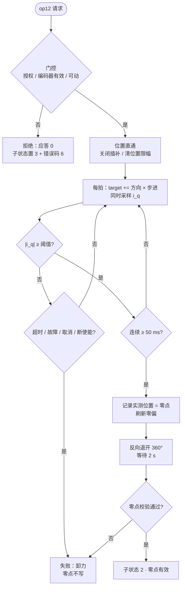

# TODO-01 机械找零（撞限位回零）——主控固件开发说明

> **读者**：主控板固件开发者。
> **目标**：读完这一份就能把「机械找零」在主控固件里实现出来，接上已经做好的上位机界面。
> **参考实现**：`com_moto` 项目 `doc/1.2-电机找零.md`（51:1 减速 + 丝杆那台机器，思路完全适用；本文按 TSLMotor 的 TMC6460 参数改写）。

---

## 0. 一句话

> **上位机只做上位机的事**：下发「方向 + 每拍步进」、请求开始 / 取消、显示状态。
> **一切裁决在主控固件**：能不能动、什么时候算「顶住了」、零点写哪个值、什么时候算失败。

上位机已经按这个分工写好了（侧栏「机械找零」页）。**固件没实现之前，卡片会显示「主控固件尚未实现找零」**，按下按钮会报错——这是预期行为。

---

## 1. 为什么需要找零

| 事实 | 后果 |
|---|---|
| 编码器只有**一圈内绝对角**（MT6701 14 bit，一圈 16384；经 `CPR_INV` 换算成 65536 counts/圈） | 分不清「第几圈」 |
| TMC6460 的 `0x155 PID_POSITION_ACTUAL` 是**32 位多圈计数器**，但**上电从 0 开始累加** | 掉电后坐标与机械真实位置无关 |
| 机构上**没有限位开关**，只有机械挡块 | 无法用开关找零 |

所以每次上电都必须把一个**物理基准**（缩回侧的机械挡块）钉成坐标原点，这个动作就是找零。

要找的是 **行程零点**，不是电角度零点：

| | 电角度零点（`0x242 PHI_E_OFFSET`） | 行程零点（本文） |
|---|---|---|
| 解决 | 换向对不对 | 坐标原点在哪 |
| 基准 | 转子磁场 | 机械挡块 |
| 掉电 | **保持**（写 EEPROM） | **丢失**（只存内存） |
| 频次 | 出厂一次 / 换磁铁时 | 每次上电 |

两者不可互替：找零依赖位置闭环，位置闭环依赖正确的电角度。**新板子的顺序是：编码器标定 → 找零。**

---

## 2. 判定「顶住了」用什么信号

电机顶住挡块后转不动，给定还在往前走 → 位置误差持续累积 → 速度环积分顶到限幅 → **电流被钳住**。

| 候选判据 | 可用性 |
|---|---|
| 位置不再增长 | ✗ 齿隙、弹性、低速都会「暂时不动」 |
| 位置误差超限 | ✗ 与推进速率强耦合，换速度就得重新整定 |
| 电流瞬时超阈 | ✗ 加速度尖峰、齿槽冲击会误判 |
| **电流超阈 + 连续保持** | ✓ 只与推力有关，与速度、齿隙无关 |

判据：

```
|i_q| ≥ k × I_rated   且   连续保持 ≥ t_c（中间任何一拍掉回阈值以下，计时清零重来）
```

本工程取值：`k = 0.4`、`I_rated = 800 mA`（= 力矩限幅）→ **阈值 320 mA**；`t_c = 50 ms`。

> **必须保证限流 > 阈值**。找零时电流上限 600 mA > 320 mA，才判得到。把限流压到 320 mA 以下，找零永远超时。

---

## 3. 上位机已经实现的部分（不用你再写）

界面：**侧栏「机械找零」页**（`src/pages/Homing.tsx`）。页面上是两张卡：
「找零控制」（方向/步进/安全确认/开始/取消）与「找零参数」（8 项工艺参数 + 写入配置 / 从主控读取）。

| 上位机做的事 | 说明 |
|---|---|
| 下发找零方向 + 每拍步进 | 默认 −15°/拍（`−1500`，单位 0.01°） |
| **下发找零参数（op 15）** | 判定系数 k、额定电流、连续确认、电流上限、推进速度上限、退开量、稳定等待、超时 —— 独立「找零参数」卡片，点「写入配置」编码成 16 字节写进主控，随后用 `op 16` 回读逐字段校验（见 4.1b）。**固件没实现 op 15/16 之前，点按钮会报错** |
| 从主控读取参数（op 16） | 连上后自动拉一次，也可随时点「从主控读取」对齐界面值；角标显示「已写入主控 / 有未写入修改 / 未读取」 |
| 安全确认勾选 | 强制操作者确认「行程内无人、无异物、方向正确」 |
| 请求开始 / 请求取消 | 只发请求，不判断能否动 |
| 轮询并显示状态 | 子状态、行程零点有效、i_q 实测、错误码（页面底部三张小卡片） |
| 参数自检 | 电流上限 ≤ 阈值、或任一字段越界时，界面直接拦下并禁用「写入配置」；固件仍必须再校验一遍 |

协议封装在 `src-tauri/src/homing.rs`（只做编码/解码，无任何判定逻辑）。

---

## 4. 固件需要实现的东西

### 4.1 主控协议：找零开始 / 状态 / 取消（op 12 / 13 / 14）

现有主控操作码是 4 / 5 / 6 / 10 / 11（上位机 `main_control` 白名单已放开到 **12 / 13 / 14**；4.1b 的参数下发还会用到 15 / 16）。

| op | 名称 | 请求载荷 | 应答 |
|---|---|---|---|
| **12** | 找零开始 | 4 字节：`[0]` 方向（`0x00` 负 / `0x01` 正）、`[1..3)` 步进 u16 **小端**（0.01° 电机端）、`[3]` 保留 | ≥1 字节：`[0] = 1` 已接受 / `0` 拒绝 |
| **13** | 找零状态 | 空 | **10 字节**（少于此长度上位机判为「未实现」） |
| **14** | 找零取消 | 空 | 任意（上位机不解析） |

`op 13` 应答布局（**必须严格按此顺序**，`homing.rs::decode_state` 已按它解码）：

| 字节 | 内容 |
|---|---|
| `[0]` | 子状态：`0` 空闲 / `1` 进行中 / `2` 成功 / `3` 失败 |
| `[1]` | 行程零点有效：`1` / `0` |
| `[2]` | 错误码（见 4.5） |
| `[3..7)` | 本次找零已用时 ms，u32 **小端** |
| `[7..9)` | i_q 实测 mA，i16 **小端**（有符号，负方向推进时为负值） |
| `[9]` | 保留，填 0 |

> `op 13` 只读。方向与步进走 `op 12`，其余工艺参数走 `op 15`（下面 4.1b）。

### 4.1b 找零参数下发（op 15 / op 16）

界面上这 8 个参数在独立的「找零参数」卡片里（`doc/TSLViewer操作手册.md` 6.3b）。
**上位机侧已实现**：`homing_write_config`（op 15）→ `homing_read_config`（op 16）→ 逐字段比对，
不一致就报「回读不一致」。**只差固件这两个操作码**；没实现之前点「写入配置」会收到超时/应答不符的错误。

| op | 名称 | 请求载荷 | 应答 |
|---|---|---|---|
| **15** | 写找零参数 | 16 字节（见下） | ≥1 字节：`[0] = 1` 已接受 / `0` 拒绝（参数越界） |
| **16** | 读找零参数 | 空 | 16 字节（与写入同布局） |

`op 15 / 16` 载荷布局（**全部 u16 小端，共 16 字节**）：

| 偏移 | 字段 | 单位/缩放 | 合法区间 | 说明 |
|---|---|---|---|---|
| `[0..2)` | `k_x1000` | ×1000 | 100…2000 | 判定系数 k（0.4 → `400`） |
| `[2..4)` | `rated_ma` | mA | 100…3000 | 额定电流刻度（判据基准） |
| `[4..6)` | `confirm_ms` | ms | 10…1000 | 连续超阈确认时间 |
| `[6..8)` | `limit_ma` | mA | 100…2000 | 找零期间电流上限 |
| `[8..10)` | `max_rpm` | RPM | 100…6000 | 推进速度上限 |
| `[10..12)` | `retreat_deg` | °（电机端） | 0…1080 | 到位后反向退开量 |
| `[12..14)` | `settle_ms` | ms | 0…10000 | 退开后稳定等待 |
| `[14..16)` | `timeout_s` | s | 5…300 | 找零超时 |

**固件必须做的参数校验**（任一条不满足就拒绝，不要把参数存进去）：

1. `limit_ma > k_x1000/1000 × rated_ma` —— 否则判据永远满足不了，找零必然超时；
2. 每个字段都在上表区间内；
3. 参数只在**空闲态**（子状态 0/2/3）可写，进行中拒绝；
4. 参数掉电不保存（跟零点一样只在内存），上电用固件默认值。

> 建议固件内部存一份「当前生效参数」，`op 16` 直接回读它，这样界面能确认写入真的生效。

### 4.2 状态机



要点：

1. **必须用位置直通**（不插补）。给定每拍阶跃前进、故意跑在实测前面，误差才会持续累积、电流才会顶到限幅。用位置斜坡就会「跟得上」，永远判不到接触。
2. **零点取实测位置，不能取给定量**——判定瞬间给定已经跑在前面很远。
3. **必须退开**（约一圈电机端 ≈ 360°）。长期顶紧会让挡块/丝母产生塑性变形，零点每次漂一点。
4. **失败绝不写零点**。

### 4.3 门控（全部在主控判定）

| 条件 | 不满足时 |
|---|---|
| 运动授权（上位机已 ARM 并授权） | 拒绝，错误码 6 |
| 编码器有效 / 电角度已标定 | 拒绝，错误码 5 |
| 控制器不在故障态 | 拒绝，错误码 2 |
| 当前无其它运动任务 | 拒绝（建议复用 6） |

上位机侧还会拦「直连模式 / 未 ARM / 未勾选安全确认」，但那只是**界面礼貌**，不是安全边界。

### 4.4 TMC6460 侧怎么落地

| 动作 | 寄存器 | 说明 |
|---|---|---|
| 切位置模式 + 关闭斜坡 | `0x100 MCC_CONFIG.MOTOR_MOTION` | `MOTION_MODE = 4 (POSITION)`；`RAMP_EN = 0` → 目标直接取 `0x152` |
| 关闭位置限幅 | `0x14C / 0x14D` | 两者**写成相同值**时无限幅；否则找零会被自己的软限位挡住 |
| 每拍推进 | `0x152 FOC.PID_POSITION_TARGET`（**32 位有符号**） | `target += dir × step`，步进单位 0.01° 电机端；节拍建议 1 ms |
| 读电流 | `0x153 FOC.PID_TORQUE_FLUX_ACTUAL` | **`[31:16]` = 力矩（i_q）**，`[15:0]` = 磁链（i_d）。别读错半字 |
| 电流换算 | — | `mA = raw × 0.20131`（`LS_RES_ON=3` 时；CSA 增益只改量程不改刻度） |
| 限流 | `0x14A FOC.PID_TORQUE_FLUX_LIMITS` | `[31:16]` 力矩上限；找零期间设 600 mA |
| 速度上限 | `0x14B FOC.PID_VELOCITY_LIMIT` | 推进速度上限（默认 2000 RPM 量级） |
| 读实测位置 | `0x155 FOC.PID_POSITION_ACTUAL`（**32 位**） | 记录零点用这个 |
| 写零点 | 固件内部 `zero_position` + `0x156 POSITION_ACTUAL_OFFSET`（或等价机制） | 使限位处去零系读数为 0 |
| 退开 | `0x152` 写 `零点 ∓ 360°/counts` | 约一圈，然后用 `0x154` 判停 |
| 置标志 | 固件状态字 | 与 `op 13` 的 `[1]` 同源 |

> 「位置直通」在 TMC6460 上就是**关掉 `RAMP_EN` 直接写 `0x152`**。这与 `com_moto` 参考实现的 `positioncommand_tim = 0` 是同一件事。

### 4.5 错误码

| 码 | 含义 | 典型原因 |
|---|---|---|
| 0 | 无 | — |
| 1 | 找零超时 | 方向反了、限流太小、半路卡死 |
| 2 | 控制器故障 | 过流 / 过温锁存、机械硬卡 |
| 3 | 已取消 | 人工取消或急停 |
| 4 | 已断使能 | 安全逻辑动作 |
| 5 | 编码器无效 | 未做电角度标定或编码器故障 |
| 6 | 未授权 | 未授予运动授权 / 状态不允许 |

### 4.6 上电与掉电

- 上电：多圈计数器从 0 开始、`zero_position = 0`、**清「行程零点有效」**。
- 掉电：零点只存在内存，**不写 EEPROM**。
- 若将来要「复位后不重新找零」，做法是记录复位前后的位置读数差反推零点（见 `com_moto` 文档 §5.3），但**普通掉电仍必须重新找零**。

---

## 5. 固件参数表

| 参数 | 建议值 | 调整原则 | 谁定 |
|---|---|---|---|
| 找零方向与步进 | 上位机下发，默认 `−1500`（−15°/拍） | **符号必须与机构一致**；过大冲击大，过小推进慢 | 上位机（op 12） |
| 判定系数 k | 0.4 | 摩擦大 / 负载重可略增；误判则增大 | 上位机可改（op 15） |
| 额定电流 | 800 mA | 判据基准，一般等于力矩限幅 | 上位机可改（op 15） |
| 判定阈值 | `k × 额定 = 320 mA`（派生，不下发） | 由上面两项算出 | 固件计算 |
| 确认时间 | 50 ms | 电流噪声大时加长 | 上位机可改（op 15） |
| 找零电流上限 | 600 mA | **必须 > 阈值**，否则永远判不到 | 上位机可改（op 15） |
| 推进速度上限 | 2000 RPM | 撞击响 / 冲击大时降低 | 上位机可改（op 15） |
| 超时 | 60 s | 行程更长时加长 | 上位机可改（op 15） |
| 退开量 | 360°（电机端，≈65536 counts） | 需要更大间隙时加长 | 上位机可改（op 15） |
| 退开稳定等待 | 2 s | 机构弹性大时加长 | 上位机可改（op 15） |

> 除「判定阈值」是派生值外，其余 8 项在界面上都可编辑（机械找零页 → 独立「找零参数」卡），
> 点「写入配置」即用 `op 15` 下发并用 `op 16` 回读校验（上位机侧已实现，等固件支持这两个 op）；
> 固件仍要自己做区间与「限流 > 阈值」校验（见 4.1b），不能盲信上位机。

---

## 6. 验收清单

固件做完后按顺序过一遍：

1. `op 13` 应答 10 字节：未找零时子状态 `0`、零点有效 `0`、i_q ≈ 0。
2. `op 15` 用默认值写入 → `op 16` 回读 16 字节逐字段一致；把 `limit_ma` 改成低于阈值 → 被拒绝（应答 `0`）。
3. `op 12` 负方向 → `op 13` 子状态变 `1`，i_q 呈「小电流推进 → 顶住后跳到限流值」两段。
4. 通过 `op 15` 把确认时间改大到 500 ms，能看到多顶一会儿才判成功（证明「连续」判据真的在跑）。
5. 成功后：子状态 `2`、零点有效 `1`、限位处去零系位置 ≈ 0。
6. 给一个小的正向目标，电机应**朝行程内部**走，而不是继续顶限位。
7. 强制超时（把方向指反）→ 子状态 `3` + 错误码 `1`，且**零点没有被写**（去零系读数仍是旧值）。
8. 找零中取消 → 子状态 `3` + 错误码 `3`，电机遇力。
9. **断电重启**：零点有效必须变回 `0`（这恰好证明零点没被错误持久化）。
10. 找零后位置稳定，但整体偏移 → 检查方向是否指到了另一端。

---

## 7. 与 `com_moto` 参考实现的对应关系

| 参考实现（com_moto） | 本工程 |
|---|---|
| `set_position_zero_collision()` | 主控固件新函数，按 §4.2 状态机实现 |
| `collisionforzero`（±1500） | `op 12` 载荷 `[0..3)` |
| `motormode = 3` + `positioncommand_tim = 0` | `0x100` 的 `MOTION_MODE=4` + `RAMP_EN=0`，直接写 `0x152` |
| `MC_GetIqdMotor1().q` vs `RATE_CURRENT_ARMS × 0.4` | `0x153[31:16]` × 0.20131 mA vs 320 mA |
| `zeroposition` / `Encoder_zero` | 固件 `zero_position` + `0x156` |
| `HAL_Delay(2000)` 退开稳定 | 同样 2 s，用 `0x154` 判停更稳 |
| `CAL_FLAG_ZERO_VALID` | 固件状态字 → `op 13` 字节 `[1]` |

---

## 8. 已知限制

1. **必须能撞到硬限位**：没有限位开关，软限位不能作为找零基准。
2. **重复精度受限**：零点精度 ≈ 「确认时间内电机可能转过的角度」；要求更高就降低推进速度或改用机械开关。
3. **推进期间占用主控**：找零是阻塞式工序，期间不要下发其它运动命令。
4. **方向参数不做机构校验**：固件只检查非零/合法，方向填反会撞另一端——所以上位机强制勾选安全确认。
5. **零点不随温度与磨损补偿**：机构热膨胀 / 挡块磨损会让不同班次零点略有差异，需定期复核。

---

## 9. 上位机侧待办（固件实现后）

- [x] 参数区接上 `op 15/16`：独立「找零参数」卡 + 「写入配置」/「从主控读取」按钮，写入后自动回读逐字段校验。
- [ ] 点「开始找零」前自动补写一次参数（现在需要手动点「写入配置」，避免每次找零都重写主控内存）。
- [ ] 参数落盘到板载 EEPROM（`StoreParams` 再加 8 个字段），换 PC 不用重填。
- [ ] 找零完成后自动把新原点写进「机械行程」页的软限位窗口。
- [ ] 失败时给错误码对应的排查建议（现在只显示码值文案）。

---

## 附：上位机相关文件

| 文件 | 作用 |
|---|---|
| `src/pages/Homing.tsx` | 页面 UI（「找零控制」卡：方向/步进/安全确认/开始/取消；「找零参数」卡：8 项参数 + 写入配置/从主控读取；顶部 3 张状态卡） |
| `src/lib/api.ts` | `homingStart` / `homingState` / `homingCancel` / `homingWriteConfig` / `homingReadConfig`，全部经 Tauri 命令直连主控（无模拟回退） |
| `src/lib/types.ts` | `HomingParams` / `HomingState` / `HomingConfig` |
| `src-tauri/src/homing.rs` | 协议编解码（含 `HomingConfig::encode/decode`）+ 13 个单测（无判定逻辑） |
| `src-tauri/src/lib.rs` | 5 个 `#[tauri::command]`，经 `main_control` 的 `op 12/13/14/15/16` 转发 |